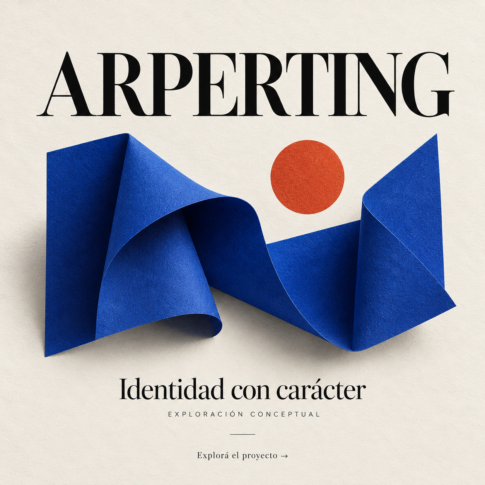

# ARPERTING · Dirección editorial

**Tipo:** exploración propia. No es un trabajo de un cliente externo.

## Necesidad

Presentar creatividad con una expresión sobria y reconocible.

## Decisiones

Fondo marfil, tipografía protagonista y un elemento escultórico azul. La composición deja espacio para que el nombre sea el primer punto de lectura.

## Aplicación posible

Cabecera, presentación comercial y piezas de identidad. Cada adaptación requiere revisar proporción y legibilidad.

## Lo que demuestra

Criterio de composición y dirección visual. No se atribuyen resultados comerciales a esta exploración.

[Volver al perfil](../../README.md#muestras) · [Conversar sobre un proyecto](../../README.md#contacto)
