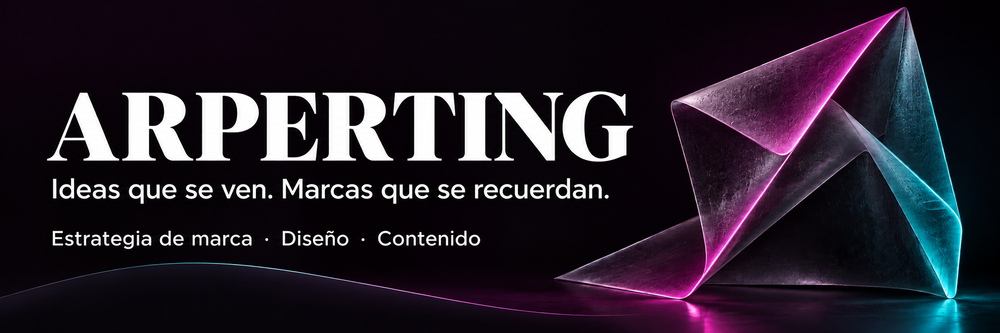
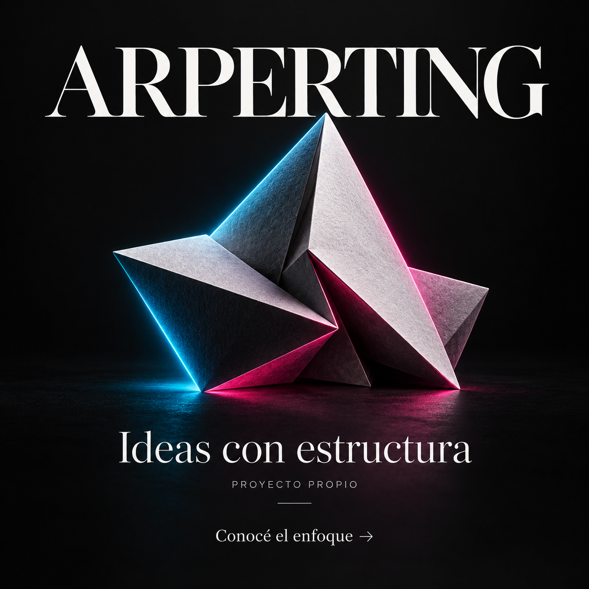
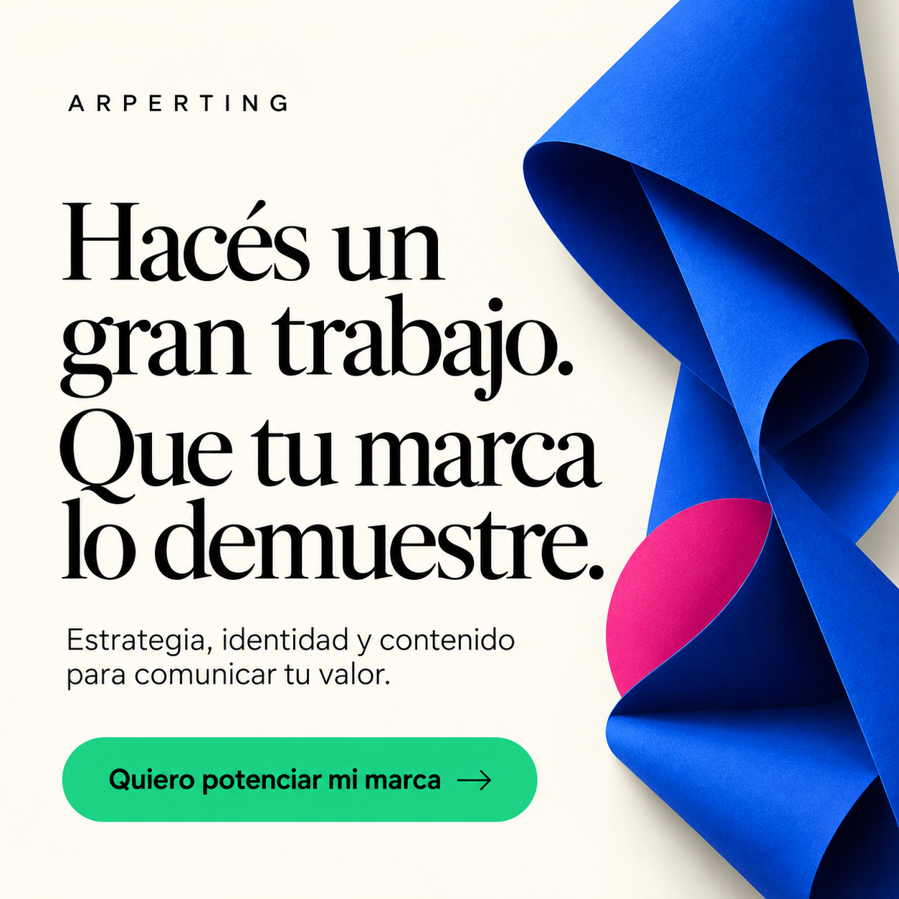

# Así construimos nuestra propia presencia digital

**Proyecto propio · ARPERTING**

Unimos identidad visual, mensajes y contenido para explicar nuestros servicios y facilitar el contacto.

## Una identidad, distintas aplicaciones

### Cabecera de marca

Nombre protagonista, mensaje de marca y una composición que reúne estrategia, diseño y contenido.

### Pieza de identidad

Pliegues, textura y acentos cian y magenta para dar continuidad a la dirección visual.

### Mensaje de servicio

Una aplicación que conecta el valor del trabajo con una invitación a conversar.

Estas piezas pertenecen al desarrollo de nuestra marca. Se presentan como evidencia de diseño, sin atribuirles resultados comerciales.

[Hablemos de la presencia de tu negocio →](../../README.md#contacto)

[← Volver al portfolio](../../README.md#portfolio)
