<h6>Inicio</h6>

<table align="center"><tr>
<td align="center"></td>
<td align="center"></td>
<td align="center"></td>
<td align="center"></td>
</tr></table>

<h1 align="center">Hacés un gran trabajo. Hagamos que tu próximo cliente lo vea.</h1>

Diseño y contenido para emprendedores que quieren ordenar su presencia digital

   

<h6>Muestras</h6>

<h2 align="center">Tu negocio, mejor presentado en cada canal</h2>

Si te falta tiempo o no sabés por dónde empezar, podemos ayudarte a ordenar, diseñar y crear.

<em>Muestras conceptuales de servicios. Las escenas e interfaces son ilustrativas; no son casos de clientes ni resultados medidos.</em>

<h3 align="center">WhatsApp Business</h3>

Menos consultas repetidas. Más claridad para elegir.

<a href="04-contenido/servicios/whatsapp.md">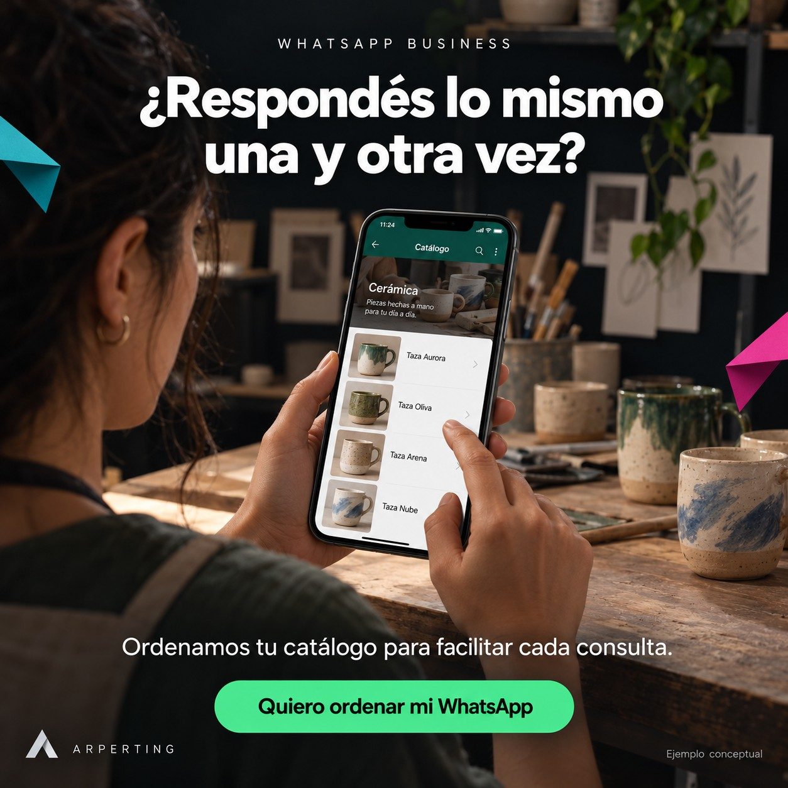</a>

<h4>¿Te pasa alguna de estas cosas?</h4>

❌ <strong>Tu foto de perfil no representa tu negocio.</strong>

✅ Diseñamos o adaptamos una imagen reconocible, incluso en tamaño pequeño.

❌ <strong>Mandás fotos sueltas cada vez que te preguntan qué vendés.</strong>

✅ Creamos imágenes y descripciones para un catálogo organizado que facilite elegir.

❌ <strong>Escribís las mismas respuestas una y otra vez.</strong>

✅ Preparamos respuestas rápidas para tus preguntas frecuentes, listas para enviar mediante atajos.

Ver todo lo que podemos preparar

❌ <strong>No se entiende qué ofrecés al entrar a tu perfil.</strong>

✅ Redactamos una descripción clara y completamos la información del negocio.

❌ <strong>Tu presentación visual está incompleta.</strong>

✅ Diseñamos una portada coherente con tu marca, cuando la función esté disponible en tu cuenta.

❌ <strong>Te escriben sin saber cuándo atendés.</strong>

✅ Configuramos horarios y un mensaje de ausencia que indique cuándo podrán recibir respuesta.

❌ <strong>No tenés un saludo preparado para nuevas consultas.</strong>

✅ Configuramos un mensaje automático de bienvenida con información útil y un próximo paso.

❌ <strong>Se mezclan consultas, pedidos y seguimientos.</strong>

✅ Te ayudamos a organizar conversaciones con etiquetas según tu forma de trabajar.

❌ <strong>No sabés cómo mantenerlo actualizado.</strong>

✅ Te guiamos para actualizar el catálogo, los datos y las respuestas de tu negocio.

<strong>Diseño y contenido:</strong> Foto, portada disponible, imágenes de catálogo y textos.

<strong>Configuración:</strong> Perfil, catálogo, horarios, bienvenida, ausencia y etiquetas.

<strong>Guía de uso:</strong> Uso de respuestas rápidas y actualización del negocio.

Las respuestas rápidas se envían mediante atajos. La bienvenida y la ausencia pueden ser automáticas; no sustituyen un asistente que responda todas las consultas.

Elegimos juntos lo que necesitás. El diseño, la configuración y el acompañamiento incluidos se detallan en tu propuesta.

No necesitás resolverlo todo de golpe. Empecemos por lo que hoy te quita tiempo.

<h3 align="center">Google Maps</h3>

Que sepan dónde estás y cómo llegar.

<a href="04-contenido/servicios/maps.md">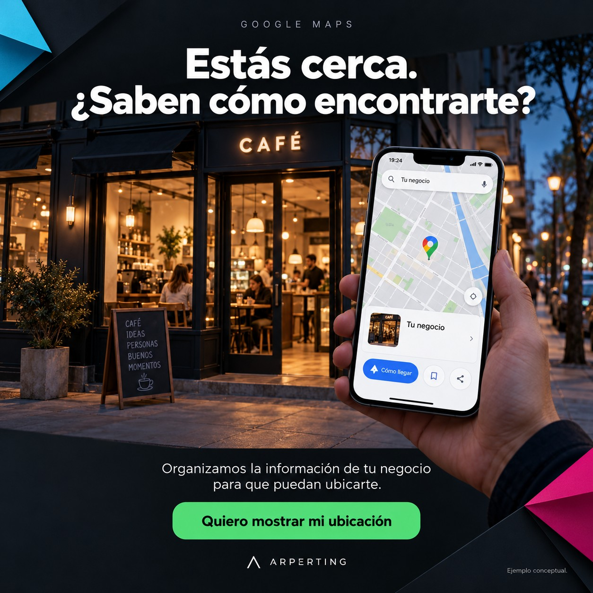</a>

<h4>¿Te pasa alguna de estas cosas?</h4>

❌ <strong>Tus clientes no encuentran bien tu local.</strong>

✅ Revisamos dirección y ubicación para facilitar que sepan cómo llegar.

❌ <strong>Los horarios están incompletos o desactualizados.</strong>

✅ Ordenamos los horarios habituales y especiales para evitar confusiones.

❌ <strong>Las fotos no muestran lo que van a encontrar.</strong>

✅ Seleccionamos y preparamos fotos claras del frente, el espacio y lo que ofrecés.

Ver todo lo que podemos preparar

❌ <strong>La información no explica bien tu actividad.</strong>

✅ Revisamos categoría, descripción y datos de contacto del negocio.

❌ <strong>No sabés cómo responder las reseñas.</strong>

✅ Preparamos criterios y ejemplos de respuesta cercanos y profesionales, sin inventar opiniones.

❌ <strong>No sabés cómo gestionar tu perfil.</strong>

✅ Te orientamos sobre acceso, verificación y actualización. La aprobación depende de Google.

<strong>Diseño y contenido:</strong> Selección de fotos, descripción y textos de respuesta.

<strong>Configuración:</strong> Revisión de datos y horarios; acompañamiento en el proceso de verificación.

<strong>Guía de uso:</strong> Actualizaciones y atención de reseñas reales.

Elegimos juntos lo que necesitás. El diseño, la configuración y el acompañamiento incluidos se detallan en tu propuesta.

No necesitás resolverlo todo de golpe. Empecemos por lo que hoy te quita tiempo.

<h3 align="center">Facebook</h3>

Una página que presente bien tu negocio.

<a href="04-contenido/servicios/facebook.md">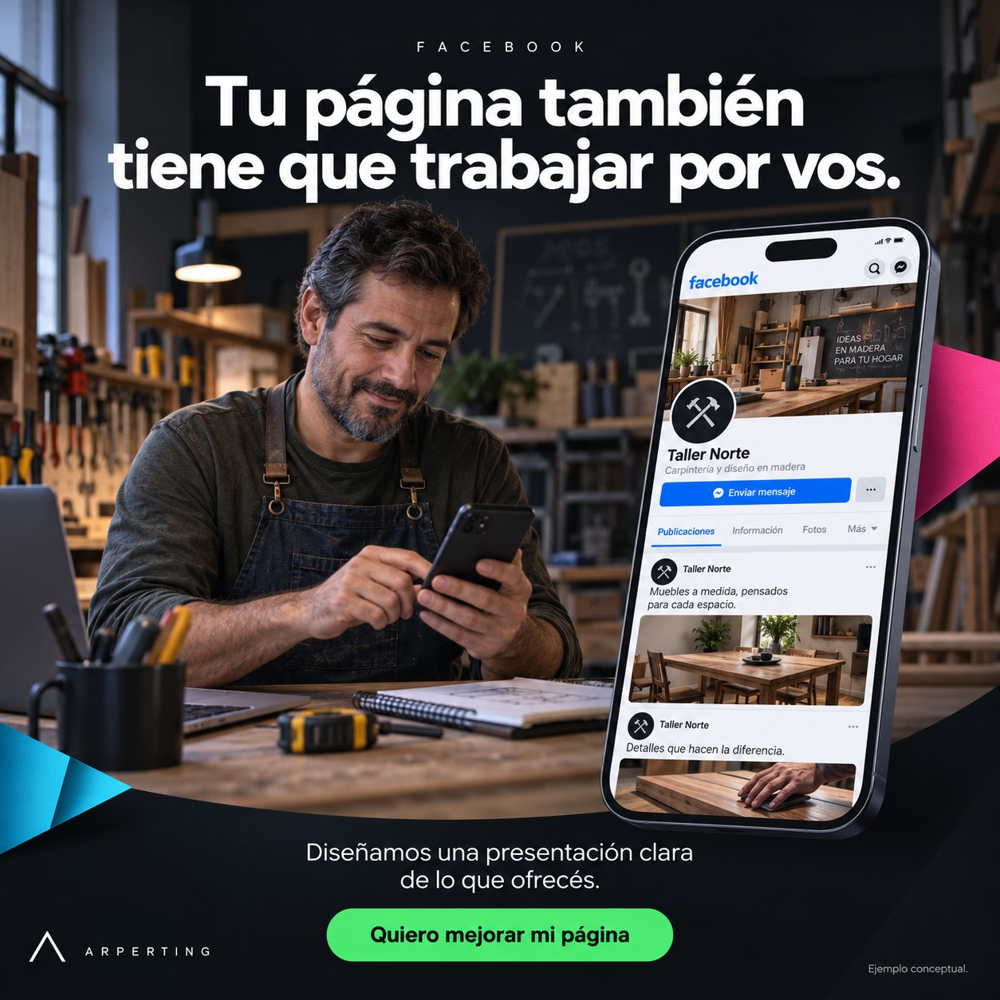</a>

<h4>¿Te pasa alguna de estas cosas?</h4>

❌ <strong>La foto y la portada no representan tu negocio.</strong>

✅ Diseñamos una presentación visual coherente para que identifiquen tu marca.

❌ <strong>No se entiende qué servicios ofrecés.</strong>

✅ Ordenamos la información y creamos piezas que expliquen tu propuesta.

❌ <strong>Publicás a las apuradas, cuando te queda tiempo.</strong>

✅ Preparamos temas, textos y diseños para un calendario acordado.

Ver todo lo que podemos preparar

❌ <strong>Las publicaciones no indican cómo consultar.</strong>

✅ Redactamos llamados a la acción claros y revisamos el recorrido hasta el contacto.

❌ <strong>Cada publicación tiene un estilo diferente.</strong>

✅ Definimos colores, tipografías y plantillas para dar continuidad a tu comunicación.

❌ <strong>Te cuesta organizar la publicación del contenido.</strong>

✅ Te guiamos con las herramientas disponibles; la programación y gestión se acuerdan por separado.

<strong>Diseño y contenido:</strong> Foto, portada, publicaciones y mensajes comerciales.

<strong>Configuración:</strong> Información de la página y recorrido hacia el contacto.

<strong>Guía de uso:</strong> Planificación y uso de herramientas de publicación.

Elegimos juntos lo que necesitás. El diseño, la configuración y el acompañamiento incluidos se detallan en tu propuesta.

No necesitás resolverlo todo de golpe. Empecemos por lo que hoy te quita tiempo.

<h3 align="center">Instagram</h3>

Un perfil que conecte lo que hacés con lo que se ve.

<a href="04-contenido/servicios/instagram.md">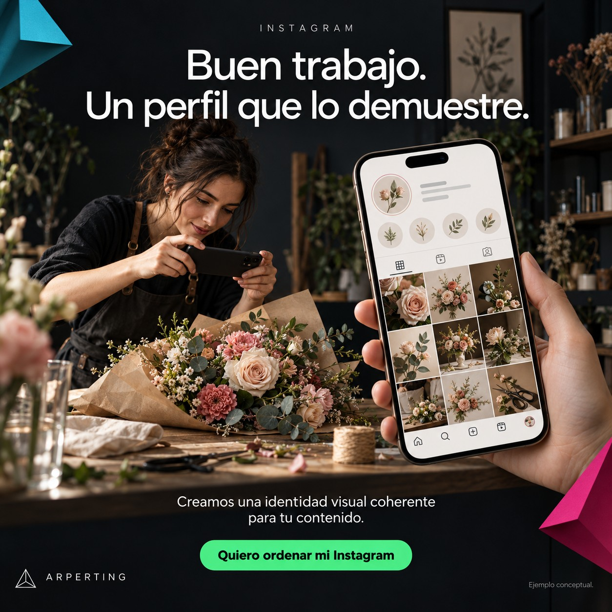</a>

<h4>¿Te pasa alguna de estas cosas?</h4>

❌ <strong>Tu biografía no explica qué hacés ni para quién.</strong>

✅ Redactamos una presentación breve y clara con un próximo paso para consultar.

❌ <strong>Tu perfil mezcla estilos y no se reconoce tu marca.</strong>

✅ Definimos una dirección visual para fotos, diseños y portadas.

❌ <strong>No sabés qué publicar.</strong>

✅ Proponemos temas y formatos vinculados con tu servicio y las preguntas de tus clientes.

Ver todo lo que podemos preparar

❌ <strong>La información importante se pierde entre publicaciones.</strong>

✅ Organizamos historias destacadas y diseñamos portadas fáciles de reconocer.

❌ <strong>Tenés material, pero no sabés cómo convertirlo en contenido.</strong>

✅ Creamos carruseles y guiones para reels a partir del material y alcance acordados.

❌ <strong>Tus publicaciones no invitan a dar el siguiente paso.</strong>

✅ Sumamos llamados a la acción y revisamos que el contacto sea claro y accesible.

<strong>Diseño y contenido:</strong> Biografía, portadas, carruseles y guiones para reels.

<strong>Configuración:</strong> Organización de la presentación del perfil y sus accesos.

<strong>Guía de uso:</strong> Continuidad visual y planificación del contenido.

Elegimos juntos lo que necesitás. El diseño, la configuración y el acompañamiento incluidos se detallan en tu propuesta.

No necesitás resolverlo todo de golpe. Empecemos por lo que hoy te quita tiempo.

<h3 align="center">TikTok</h3>

Tu trabajo tiene historias para mostrar.

<h4>¿Te pasa alguna de estas cosas?</h4>

❌ <strong>Querés mostrar tu trabajo, pero no sabés cómo empezar.</strong>

✅ Transformamos tus ideas en guiones breves con un gancho inicial claro.

❌ <strong>No tenés tiempo para editar cada video.</strong>

✅ Editamos el material acordado con cortes, subtítulos y un cierre que invite a consultar.

❌ <strong>Grabás sin saber qué tomas necesitás.</strong>

✅ Te damos una guía sencilla de planos, luz y encuadre para mostrar tu trabajo.

Ver todo lo que podemos preparar

❌ <strong>Cada video se siente desconectado del anterior.</strong>

✅ Definimos temas y una línea de contenido para darle continuidad a tu presencia.

❌ <strong>Se ve lo que hacés, pero no queda claro qué ofrecés.</strong>

✅ Conectamos la demostración con un mensaje que explique tu servicio.

❌ <strong>No sabés qué ajustar en los siguientes videos.</strong>

✅ Te orientamos para revisar las métricas disponibles y probar mejoras sin prometer viralidad.

<strong>Diseño y contenido:</strong> Ideas, guiones, edición y subtítulos.

<strong>Configuración:</strong> Presentación del perfil y organización del material acordado.

<strong>Guía de uso:</strong> Grabación y lectura básica del rendimiento del contenido.

Elegimos juntos lo que necesitás. El diseño, la configuración y el acompañamiento incluidos se detallan en tu propuesta.

No necesitás resolverlo todo de golpe. Empecemos por lo que hoy te quita tiempo.

<a href="#inicio">↑ Volver al inicio</a>

<strong>PACKS Y PRECIOS</strong>

<h2 align="center">Empezá por lo que tu negocio necesita hoy</h2>

¿Te falta tiempo, no sabés cómo configurar tus redes o sentís que tu imagen no refleja tu trabajo? En ARPERTING te escuchamos y te ayudamos a dar el próximo paso con diseño, contenido y acompañamiento.

Elegí la necesidad que querés resolver. Cada pack incluye asesoramiento personalizado y un alcance concreto.

PACK 01 · Primer Impulso

<h3 align="center">WhatsApp Business</h3>

<strong>Menos mensajes repetidos. Más claridad para elegir.</strong>

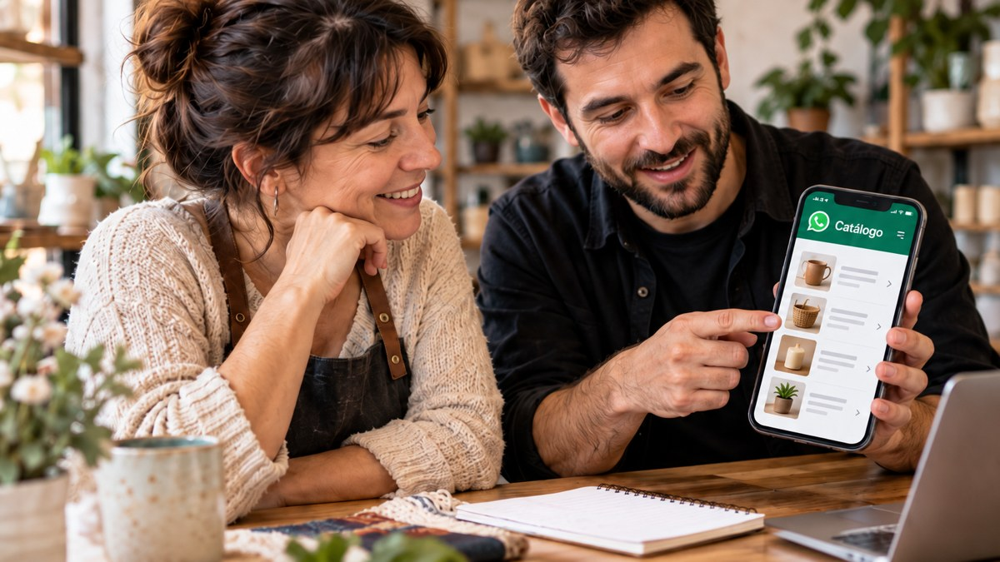

Aplicación ilustrativa

<strong>¿Mandás fotos sueltas y respondés siempre lo mismo?</strong> Ordenamos tu presentación y tu catálogo para que cada consulta empiece con información clara.

Qué incluye este pack
<ul>
<li>✓ Asesoramiento personalizado sobre tu negocio y sus consultas habituales.</li>
<li>✓ Foto de perfil y descripción comercial acordes a tu identidad.</li>
<li>✓ Catálogo inicial de hasta 10 productos o servicios, con imágenes y descripciones.</li>
<li>✓ Horarios y datos de contacto completos.</li>
<li>✓ Mensajes de bienvenida y ausencia.</li>
<li>✓ Respuestas rápidas mediante atajos y etiquetas para organizar conversaciones.</li>
<li>✓ Portada cuando la función esté disponible en tu cuenta.</li>
<li>✓ Guía para usar y actualizar tu WhatsApp Business.</li>
</ul>

Visita presencial a coordinar según zona. Las respuestas rápidas se envían mediante atajos; no son un chatbot.

Precio anticipado

<strong>$150.000 ARS</strong>

Contratando hasta el 31 de octubre de 2026.

Valor del pack: $165.000 ARS.

PACK 02 · Presencia que conecta

<h3 align="center">Facebook</h3>

<strong>Que tu Facebook muestre lo que tu negocio vale.</strong>

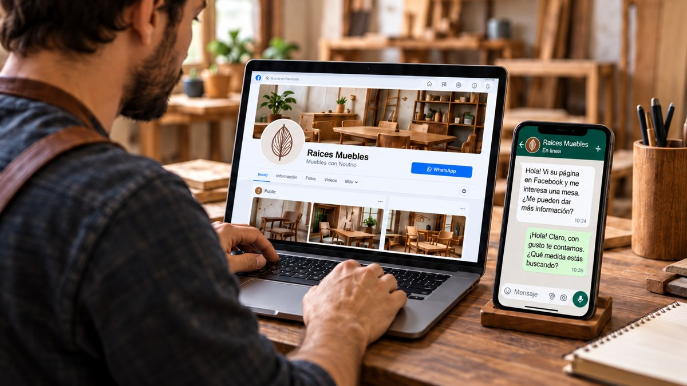

Aplicación ilustrativa

<strong>¿Tu página no refleja la calidad de lo que ofrecés?</strong> Le damos una presentación coherente y contenido que explique tu propuesta e invite a consultar por WhatsApp.

Qué incluye este pack
<ul>
<li>✓ Asesoramiento personalizado según las necesidades del negocio.</li>
<li>✓ Portada profesional y foto de perfil adaptada a tu marca.</li>
<li>✓ 5 imágenes iniciales con sus 5 redacciones y llamados a la acción.</li>
<li>✓ Contenido para presentar, explicar un servicio, responder dudas, mostrar tu trabajo e invitar a consultar.</li>
<li>✓ Información, categoría, horarios y ajustes de la página según corresponda.</li>
<li>✓ Botón vinculado a WhatsApp Business para continuar las consultas.</li>
<li>✓ Publicación fijada de presentación.</li>
<li>✓ Guía para continuar publicando.</li>
</ul>

Incluye diseño y puesta a punto inicial. Publicidad paga y gestión mensual se cotizan aparte.

Precio anticipado

<strong>$160.000 ARS</strong>

Contratando hasta el 29 de octubre de 2026.

Precio promocional: $175.000 ARS, del 30 de octubre al 15 de noviembre de 2026.

PACK 03 · Cerca de tus clientes

<h3 align="center">Google Maps</h3>

<strong>Estás cerca. Que puedan encontrarte.</strong>

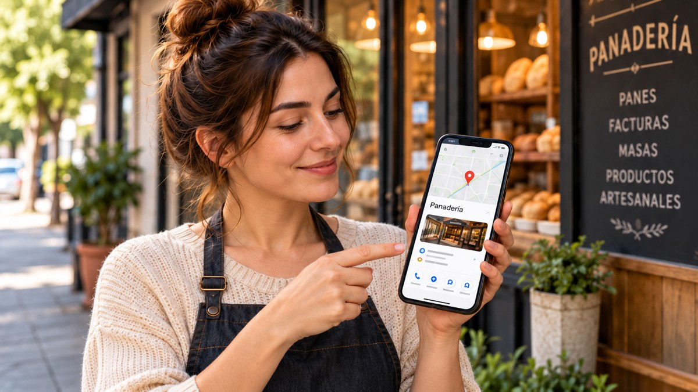

Aplicación ilustrativa

<strong>¿Cuesta encontrar tu negocio o saber cuándo atendés?</strong> Preparamos un perfil con información clara para facilitar que te ubiquen, conozcan tu actividad y se contacten.

Qué incluye este pack
<ul>
<li>✓ Asesoramiento personalizado y asistido.</li>
<li>✓ Alta o revisión de tu Perfil de Empresa, según elegibilidad.</li>
<li>✓ Acompañamiento en el proceso de verificación.</li>
<li>✓ Categoría y descripción acordes a la actividad.</li>
<li>✓ Ubicación o zona de servicio, según el tipo de negocio.</li>
<li>✓ Horarios habituales y datos de contacto.</li>
<li>✓ Preparación y carga de logo, portada y fotos aportadas del negocio.</li>
<li>✓ Guía para actualizar información y responder reseñas reales.</li>
</ul>

El perfil de Google es gratuito: el pack cubre el trabajo de ARPERTING. La verificación depende de Google. No incluye anuncios ni garantiza posiciones.

Precio anticipado

<strong>$180.000 ARS</strong>

Contratando hasta el 29 de octubre de 2026.

Precio sugerido promocional: $220.000 ARS, del 30 de octubre al 15 de noviembre de 2026.

PACK 04 · Marca que se nota

<h3 align="center">Instagram</h3>

<strong>Tu trabajo merece un perfil que lo demuestre.</strong>

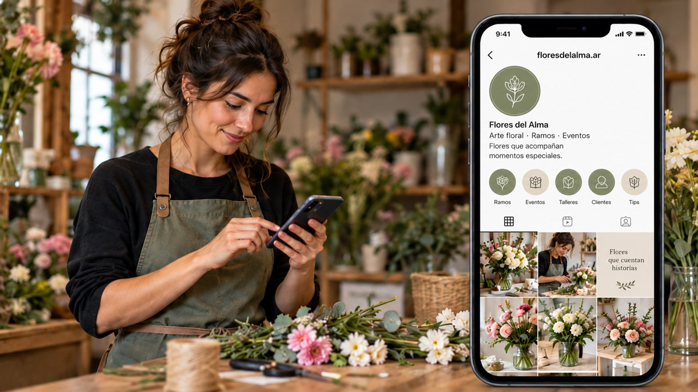

Aplicación ilustrativa

<strong>¿Tu perfil mezcla estilos o te cuesta explicar qué ofrecés?</strong> Unimos identidad, contenido y mensajes para mostrar tu trabajo con coherencia y facilitar el paso a WhatsApp.

Qué incluye este pack
<ul>
<li>✓ Asesoramiento personalizado y asistido.</li>
<li>✓ Foto de perfil adaptada a tu marca.</li>
<li>✓ Historias destacadas con iconos personalizados.</li>
<li>✓ Colores y estilo visual acordes a tu identidad.</li>
<li>✓ 5 imágenes iniciales con sus redacciones.</li>
<li>✓ 5 carruseles con redacción y llamados a la acción.</li>
<li>✓ Biografía y ajustes del perfil según tu negocio.</li>
<li>✓ Enlace a WhatsApp Business para continuar las consultas.</li>
</ul>

La cantidad de iconos y de láminas por carrusel se define en la propuesta. Publicidad paga y gestión mensual se cotizan aparte.

Precio anticipado

<strong>$160.000 ARS</strong>

Contratando hasta el 29 de octubre de 2026.

Precio sugerido promocional: $175.000 ARS, del 30 de octubre al 15 de noviembre de 2026.

<strong>¿No sabés cuál elegir? Contanos qué te está costando y te ayudamos a priorizar.</strong>

Antes de contratar, acordamos tiempos, revisiones, materiales y forma de pago. Los packs trabajan sobre tu identidad actual; un logo nuevo se cotiza por separado.

<a href="#inicio">↑ Volver al inicio</a>

<h6>Soluciones</h6>

## Que tu comunicación esté a la altura de tu trabajo

Tu negocio ya tiene valor. Trabajemos en cómo lo mostrás.

<h3>Que tu marca refleje lo que valés</h3>

¿Tu negocio se ve menos profesional de lo que es?

<strong>Una identidad que te represente.</strong> Diseño y presentaciones que comuniquen el valor de tu trabajo.

<h3>Que cada publicación se sienta tuya</h3>

¿Cada pieza parece de una marca diferente?

<strong>Un estilo reconocible.</strong> Colores, tipografías y recursos que den coherencia a tu comunicación.

<h3>Que se entienda por qué elegirte</h3>

¿Te cuesta explicar qué hace diferente a tu negocio?

<strong>Un mensaje claro.</strong> Ordenamos qué ofrecés, para quién y cómo dar el próximo paso.

<h3>Que publicar deje de ser un pendiente</h3>

¿No tenés tiempo para pensar qué publicar?

<strong>Contenido con una dirección.</strong> Definimos temas y creamos las piezas acordadas para tus canales.

**Vos conocés tu negocio. Nosotros aportamos estrategia, diseño y contenido para comunicarlo.**

<table>
<tr>
<td width="50%" valign="top">
<strong>Mostrá el valor que ya tiene tu negocio.</strong> Démosle una expresión clara, coherente y propia.
</td>
<td width="50%" valign="top"><a href="https://wa.me/541122559596?text=Hola%2C%20ARPERTING.%20Quiero%20mostrar%20mejor%20el%20valor%20de%20mi%20negocio%20y%20conocer%20c%C3%B3mo%20podemos%20trabajarlo.">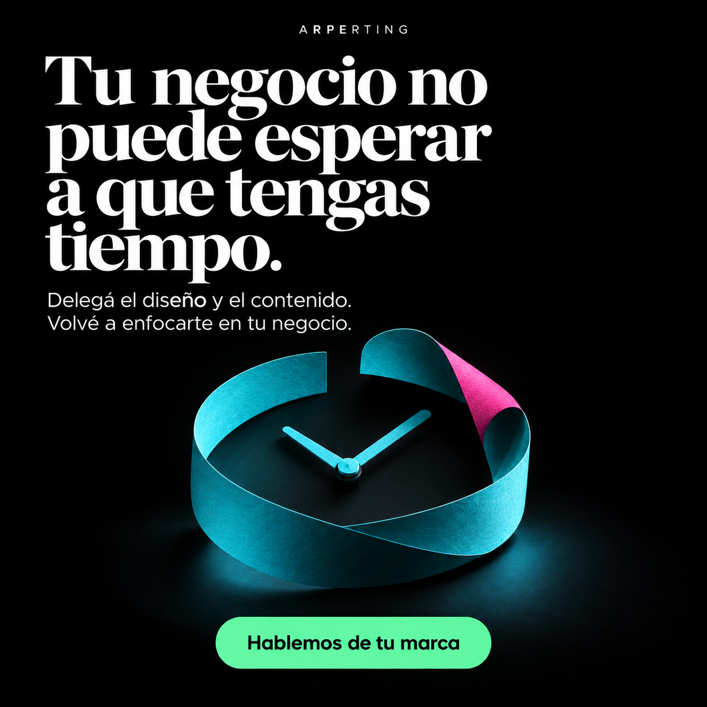</a>
<strong>Recuperá espacio para lo que necesita de vos.</strong> Definamos qué tareas de comunicación podés delegar.
</td>
</tr>
</table>

## Una imagen abre la conversación. El mensaje le da una razón para continuar.

Explorá nuestras decisiones de diseño. **Estas muestras son proyectos propios y exploraciones conceptuales de ARPERTING.**

<h3 align="center">Identidad con carácter editorial</h3>

<em>Exploración conceptual · ARPERTING</em>

Jerarquía, textura y personalidad para una presentación visual propia.

<a href="04-contenido/casos/direccion-editorial.md">Explorar el proyecto →</a>

<h3 align="center">Así construimos nuestra propia presencia digital</h3>

<em>Proyecto propio · ARPERTING</em>

Unimos identidad visual, mensajes y contenido para explicar nuestros servicios y facilitar el contacto.

<a href="04-contenido/casos/presencia-digital.md">Explorar el diseño →</a>

<a href="#inicio">↑ Volver al inicio</a>

## Elegí por dónde empezar

Una necesidad concreta, un alcance claro y entregables que puedas usar.

<strong>Ordenar mi marca</strong>

Revisamos lo que ya tenés y definimos un mensaje y una dirección visual. Podés recibir paleta, tipografías, aplicaciones prioritarias y pautas de uso.

<strong>Ordenar mi contenido</strong>

Definimos temas, mensajes y formatos. Podés recibir textos y piezas para los canales acordados, con recursos organizados para dar continuidad.

<strong>Presentar mejor mi servicio</strong>

Damos forma a tu propuesta para que se entienda qué ofrecés. Podés recibir una presentación comercial o piezas digitales con mensajes y jerarquía claros.

Ver la propuesta visual de servicios

<a href="#contacto">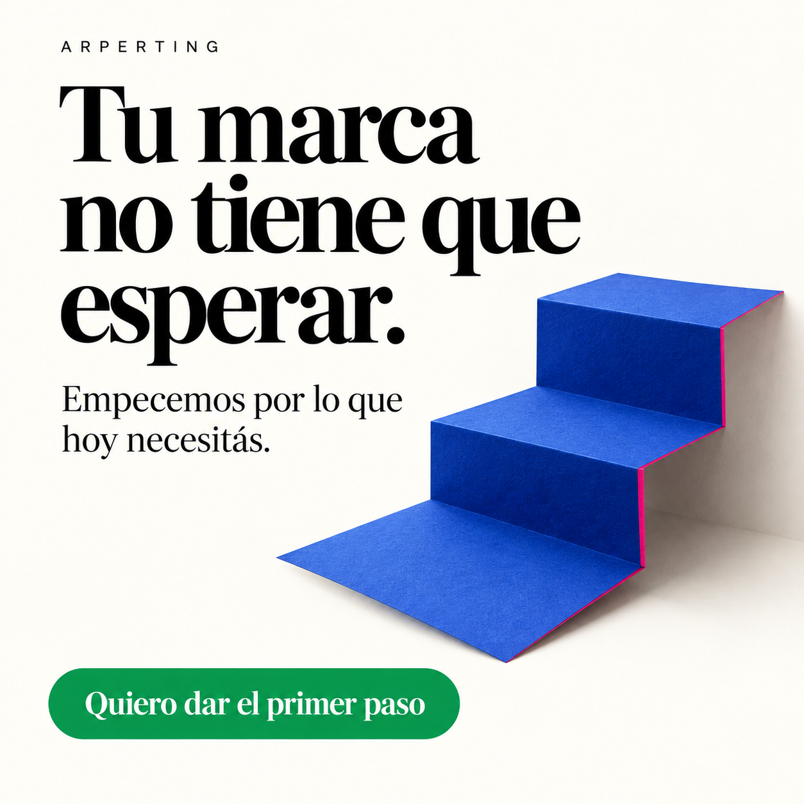</a>

**Antes de empezar, acordamos alcance, formatos, tiempos y revisiones.** Los archivos editables y los servicios de publicación o gestión se especifican en cada propuesta.

<a href="#inicio">↑ Volver al inicio</a>

<h6>Proceso</h6>

## Un proceso claro para que sepas qué esperar

<a href="#pasos">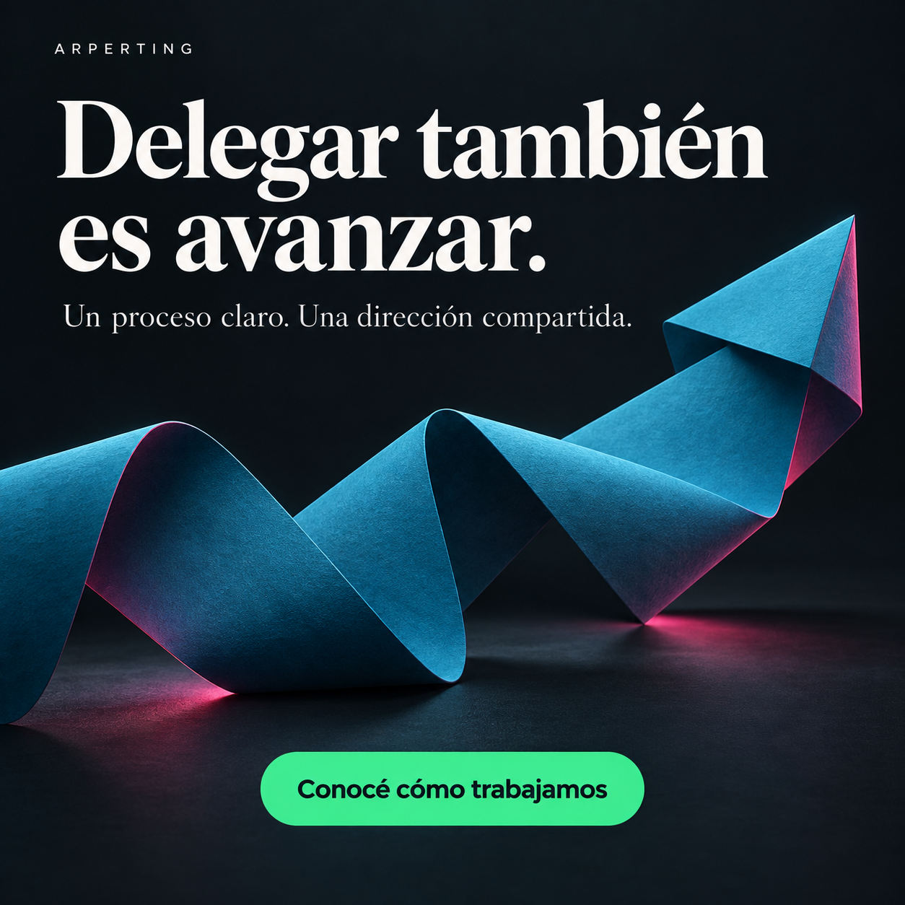</a>

Sabé qué vamos a hacer, qué necesitamos de vos y cómo revisaremos cada entrega.

1. **Te escuchamos.** Conocemos tu negocio, público y necesidad.
2. **Definimos el alcance.** Acordamos objetivos, piezas, tiempos y revisiones.
3. **Creamos con intención.** Desarrollamos propuestas y explicamos las decisiones.
4. **Revisamos y entregamos.** Ajustamos y preparamos los formatos acordados.

> La creatividad tiene más fuerza cuando sabemos qué queremos comunicar.

<a href="#inicio">↑ Volver al inicio</a>

## Detrás de ARPERTING hay una mirada y una conversación

**Soy Dave Vergara. Trabajo en creatividad, diseño y comunicación digital.**

Con ARPERTING busco ayudarte a mostrar el valor de tu negocio con una dirección clara. El punto de partida es entender qué hacés, a quién querés llegar y qué necesitás comunicar.

Me interesa que puedas entender las decisiones del proyecto: qué queremos decir, por qué elegimos una imagen y qué acción esperamos facilitar.

**Tu conocimiento del negocio es parte del trabajo. La estrategia y el diseño le dan forma para compartirlo.**

<a href="#inicio">↑ Volver al inicio</a>

<h6>Ideas</h6>

## Ideas para mirar tu marca con otros ojos

<table><tr>
<td width="50%" valign="top"><a href="04-contenido/articulos/tiempo-y-contenido.md">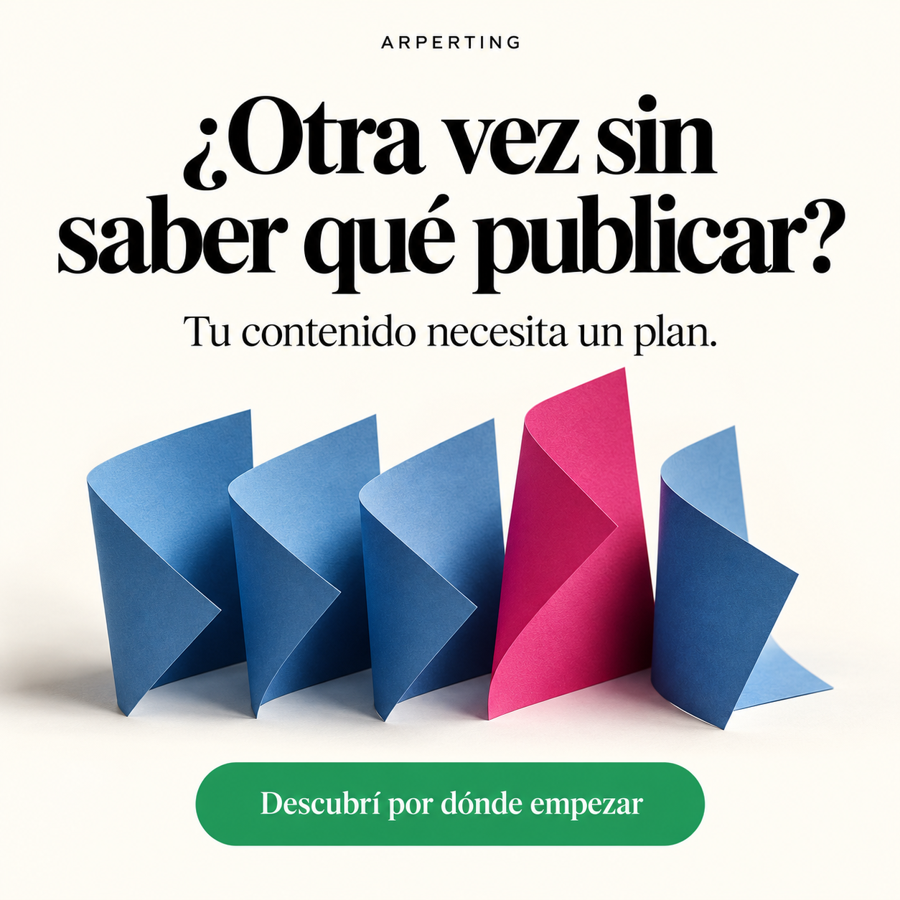</a>
<strong>¿Otra vez sin saber qué publicar?</strong> Tres preguntas para dejar de empezar desde cero.
<a href="04-contenido/articulos/tiempo-y-contenido.md">Leer: cómo ordenar tu contenido →</a></td>
<td width="50%" valign="top"><a href="04-contenido/articulos/perfil-que-comunica.md">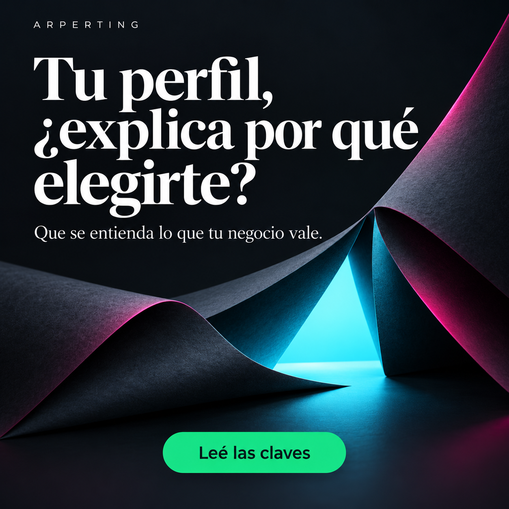</a>
<strong>¿Tu perfil explica por qué elegirte?</strong> Revisá si se entiende qué ofrecés y cómo contactarte.
<a href="04-contenido/articulos/perfil-que-comunica.md">Leer: las claves de un perfil claro →</a></td>
</tr></table>

<a href="#inicio">↑ Volver al inicio</a>

## Antes de escribirnos

¿Puedo empezar por una sola pieza?

Sí. Conversamos sobre una necesidad puntual y definimos el alcance.

¿Pueden trabajar con mi identidad actual?

Sí. Revisamos sus elementos y evaluamos cómo aplicarlos al proyecto.

¿Cómo se define el presupuesto?

Podés consultar nuestros <a href="#packs-y-precios">packs y precios</a> como punto de partida. Si necesitás otro alcance, armamos una propuesta según las piezas, formatos, tiempos y revisiones.

<a href="#inicio">↑ Volver al inicio</a>

## Hagamos visible lo que tu negocio vale

**No necesitás llegar con todo resuelto. Empecemos por entender tu negocio.**

Para orientar la conversación, contanos:

1. Qué ofrecés y a quién querés llegar.
2. Dónde mostrás hoy tu trabajo; podés compartir tu perfil.
3. Qué te gustaría comunicar mejor o delegar.

Con esa información podemos conversar sobre prioridades y definir una propuesta con alcance concreto.

[Escribinos por WhatsApp](https://wa.me/541122559596?text=Hola%2C%20ARPERTING.%20Quiero%20mostrar%20mejor%20el%20valor%20de%20mi%20negocio%20y%20conocer%20c%C3%B3mo%20podemos%20trabajarlo.). Contanos qué necesitás y conversemos sobre el alcance.

**Canales en preparación.** Pronto podrás conocer nuestras novedades en instagram, facebook, tiktok. Mientras tanto, conversemos por WhatsApp.

Mensaje para iniciar la conversación:

> Hola, ARPERTING. Mi negocio es ___. Ofrezco ___. Me gustaría mostrar mejor ___ y conocer cómo podemos trabajarlo.

<strong>Vos hacés que tu negocio avance. Nosotros te ayudamos a mostrar por qué elegirlo.</strong>

<table align="center"><tr>
<td align="center"></td>
<td align="center"></td>
<td align="center"></td>
<td align="center"></td>
</tr></table>

ARPERTING · Ideas que se ven. Marcas que se recuerdan.

<a href="#inicio">↑ Volver al inicio</a>

