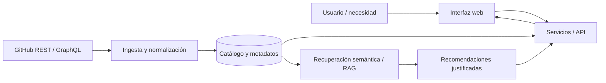

<div align="center">


<br/>

**OPEN SOURCE DISCOVERY · AI-ASSISTED ARCHITECTURE · DEVELOPER TOOLS**

**Proyecto colaborativo · No Country 2026 · Vista de presentación / versión de prueba**

[**El desafío**](#el-desafio) · [**La solución**](#la-solucion) · [**Arquitectura**](#arquitectura-propuesta) · [**Documentación**](#centro-de-documentacion) · [**Equipo**](#nuestro-equipo)

</div>

---

> ### Una mejor arquitectura comienza con mejores decisiones.
>
> **OpenBridge** plantea un puente entre el universo de herramientas open source y las necesidades reales de los equipos que construyen software. Descubrir, evaluar, conectar y recomendar: **menos tiempo explorando opciones dispersas; más criterio para crear productos.**

## El desafio

En el escenario definido por **No Country**, arquitectos y líderes técnicos dedican **entre 15 y 20 horas por proyecto** a investigar manualmente librerías, herramientas y servicios open source. Comparar información dispersa dificulta valorar mantenimiento, compatibilidad y posibilidades de integración.

**Nuestra oportunidad:** convertir múltiples fuentes técnicas en un recorrido de descubrimiento claro y recomendaciones contextualizadas.

> **Nota metodológica:** las 15–20 horas son un dato del [brief del desafío](https://drive.google.com/file/d/1jl3HN2pWct3DZLqGiusHl49pQeCpu_EO/view). No representan un ahorro medido ni un resultado obtenido por el equipo.

## La solucion

| | Capacidad propuesta | Valor para quien desarrolla |
|---|---|---|
| **01** | **Catálogo inteligente** | Descubrir proyectos según categoría, lenguaje, licencia y señales de mantenimiento. |
| **02** | **Fichas técnicas útiles** | Revisar métricas, actividad, licencias y posibilidades de uso. |
| **03** | **Integraciones con contexto** | Entender cómo conectar herramientas mediante API, SDK, Docker o webhooks. |
| **04** | **Asistente de arquitectura con IA** | Recibir alternativas de stack justificadas según el problema del negocio. |

**Alcance objetivo del desafío:** catálogo de al menos **100 repositorios**, filtros y búsqueda, ficha de salud del proyecto, ingesta automatizada desde GitHub y asistente con recuperación contextual (RAG).

> Estas capacidades son **objetivos de desarrollo**, no funcionalidades declaradas como terminadas.

## De una idea a una arquitectura

**Ejemplo ilustrativo, no una demostración del software:**

**Necesidad:** «Estoy creando un e-commerce B2B para operaciones logísticas».

```text
NECESIDAD DEL NEGOCIO
        │
        ▼
CONTEXTO + REQUISITOS
        │
        ▼
CATÁLOGO DE REPOSITORIOS
        │
        ▼
RELEVANCIA + MANTENIMIENTO + LICENCIA
        │
        ▼
STACK SUGERIDO + PATRONES DE INTEGRACIÓN
        │
        ▼
EXPLICACIÓN Y REVISIÓN HUMANA
```

El sistema debe apoyar decisiones técnicas, no reemplazar la evaluación de seguridad, licencias, costos, soporte o compatibilidad.

## Arquitectura propuesta



**Puntos de diseño pendientes de validar:**

- Estrategia de sincronización y límites de las API de GitHub.
- Modelo de indicadores de salud y actualización del repositorio.
- Recuperación semántica, calidad de las fuentes y trazabilidad de recomendaciones.
- Estructuración de integraciones, compatibilidad y ejemplos reproducibles.
- Contrato frontend/backend, pruebas, despliegue y seguridad.

**Tecnologías:** el desafío sugiere Next.js/React, FastAPI o Node.js, PostgreSQL/pgvector o Qdrant y herramientas para RAG. **Ninguna de estas alternativas se declara aquí como tecnología implementada sin validación del equipo.**

## Centro de documentacion

> **Evaluadores:** pueden comenzar por el documento de requisitos, continuar por el espacio de gestión y revisar las tareas y decisiones. Estos enlaces llevan a fuentes existentes, pero su **acceso público debe verificarse antes de la entrega final**.

| Fuente | Qué permite consultar |
|---|---|
| [**Brief oficial de No Country**](https://drive.google.com/file/d/1jl3HN2pWct3DZLqGiusHl49pQeCpu_EO/view) | Problema, alcance, entregables y tecnologías sugeridas. |
| [**Gestión del proyecto · Notion**](https://app.notion.com/p/3ff997f897ee81f3a11cea1379ea28a6?pvs=204) | Centro de coordinación y organización del equipo. |
| [**Documentación y entregables**](https://app.notion.com/p/3ff997f897ee81d6bc48d1d36b2603fd?pvs=204) | Requisitos, evidencias y control de entrega. |
| [**Tablero de tareas**](https://app.notion.com/p/9aa45edd39dd45ec96f91a1962b9b932?pvs=204) | Avances, responsables y criterios de aceptación. |
| [**Decisiones y riesgos**](https://app.notion.com/p/def7d0d2fd044dd0a5ec18cfcf964659?pvs=204) | Registro de acuerdos, incertidumbres y bloqueos. |
| [**Reuniones**](https://app.notion.com/p/d798a39cb79b4d5284d80650516b6123?pvs=204) | Registro del trabajo colaborativo. |
| [**Carpeta OpenBridge · Drive**](https://drive.google.com/drive/folders/1EQS0Utv815jEGypP3ApMJfVABJA02h7B) | Recursos y archivos compartidos del proyecto. |

**Pendientes para completar esta navegación:** enlace del repositorio de código del equipo, prototipo UX/UI, documentación técnica validada, demo navegable, video de presentación y resultados de pruebas. No se incluyen vínculos ficticios.

## Nuestro equipo

| Integrante | Rol | Enfoque |
|---|---|---|
| **David Vergara** | Project Manager | Alcance, planificación, riesgos, seguimiento y documentación. |
| **Fabián** | Frontend / UX-UI | Experiencia de uso, interfaz y diseño responsive. |
| **Andrés** | Ingeniero de IA | Enfoque del asistente, RAG y evaluación de respuestas. |
| **Jeison** | Datos / Machine Learning | Preparación de información, relevancia y calidad de datos. |

La distribución técnica fina se confirma con cada integrante; **backend, integración y pruebas todavía requieren definición de responsables**.

## Estado y transparencia

| Dimensión | Estado en esta presentación |
|---|---|
| Problema de negocio y requisitos | **Documentados** en el brief. |
| Dirección del producto | **Propuesta definida**. |
| Coordinación y documentación | **Espacio real identificado** en Notion. |
| Arquitectura | **Conceptual**, pendiente de validación técnica. |
| Catálogo, asistente, ingesta y datos | **Entrega y evidencias pendientes de verificar**. |
| Demo pública y despliegue | **No confirmados**. |
| README visual | **Versión de prueba publicada**, complementable por el equipo. |

## Camino hacia la demo

1. **Alinear alcance:** validar las funciones mínimas que se mostrarán.
2. **Construir un recorrido completo:** búsqueda → ficha → recomendación.
3. **Integrar y probar:** datos reales, contratos entre componentes y respuesta reproducible.
4. **Documentar con evidencia:** capturas, instrucciones de ejecución, resultados y limitaciones.
5. **Presentar al jurado:** demo, decisiones técnicas, aportes del equipo y próximos pasos.

---

<div align="center">

### Menos búsqueda. Mejores decisiones.

**OpenBridge** · Descubrir tecnologías es el comienzo; integrarlas con criterio es el objetivo.

[Inicio](#el-desafio) · [Documentación](#centro-de-documentacion) · [Equipo](#nuestro-equipo)

<sub>Simulación laboral No Country · Documento de presentación conceptual · Octubre de 2026</sub>

</div>