<div align="center">

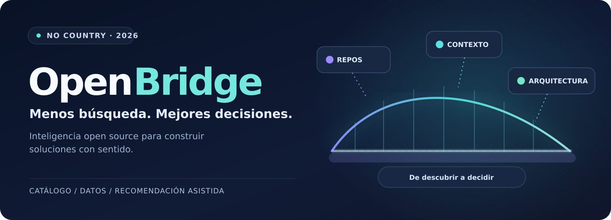

<br/>

**OPEN SOURCE DISCOVERY · AI-ASSISTED ARCHITECTURE · DEVELOPER TOOLS**

**Proyecto colaborativo · No Country 2026 · Vista de presentación / versión de prueba**

[**El desafío**](#el-desafio) · [**Producto**](#producto) · [**Arquitectura**](#arquitectura-propuesta) · [**Documentación**](#centro-de-documentacion) · [**Equipo**](#nuestro-equipo)

</div>

---

> ### Una mejor arquitectura comienza con mejores decisiones.
>
> **OpenBridge** plantea un puente entre el universo de herramientas open source y las necesidades reales de los equipos que construyen software. Descubrir, evaluar, conectar y recomendar: **menos tiempo explorando opciones dispersas; más criterio para crear productos.**

## El desafio

En el escenario definido por **No Country**, arquitectos y líderes técnicos dedican **entre 15 y 20 horas por proyecto** a investigar manualmente librerías, herramientas y servicios open source. Comparar información dispersa dificulta valorar mantenimiento, compatibilidad y posibilidades de integración.

**Nuestra oportunidad:** convertir múltiples fuentes técnicas en un recorrido de descubrimiento claro y recomendaciones contextualizadas.

> **Nota metodológica:** las 15–20 horas son un dato del [brief del desafío](https://drive.google.com/file/d/1jl3HN2pWct3DZLqGiusHl49pQeCpu_EO/view). No representan un ahorro medido ni un resultado obtenido por el equipo.

## La solucion

| | Capacidad propuesta | Valor para quien desarrolla |
|---|---|---|
| **01** | **Catálogo inteligente** | Descubrir proyectos según categoría, lenguaje, licencia y señales de mantenimiento. |
| **02** | **Fichas técnicas útiles** | Revisar métricas, actividad, licencias y posibilidades de uso. |
| **03** | **Integraciones con contexto** | Entender cómo conectar herramientas mediante API, SDK, Docker o webhooks. |
| **04** | **Asistente de arquitectura con IA** | Recibir alternativas de stack justificadas según el problema del negocio. |

**Alcance objetivo del desafío:** catálogo de al menos **100 repositorios**, filtros y búsqueda, ficha de salud del proyecto, ingesta automatizada desde GitHub y asistente con recuperación contextual (RAG).

> Estas capacidades son **objetivos de desarrollo**, no funcionalidades declaradas como terminadas.

<a id="producto"></a>
## Producto en evolución · Acceso al prototipo

**El proyecto se entiende mejor cuando se puede explorar.** Este espacio da protagonismo al avance que está preparando el equipo y facilita que los evaluadores lleguen a la experiencia actual sin buscar el enlace entre documentos.

<div align="center">

<a href="assets/showcase/OpenBridge_Recorrido_Real_57s.mp4" title="Ver la demostración original de usabilidad de OpenBridge (57 segundos)">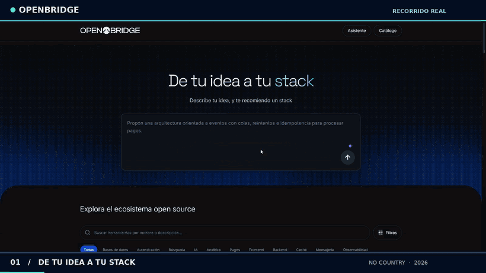</a>

<sub>**Grabación real del 27/10/2026.** La animación resume ocho momentos de la interfaz, sin mostrar funciones simuladas. Tocá la imagen para abrir el recorrido completo.</sub>

<br />

<a href="assets/showcase/OpenBridge_Recorrido_Real_57s.mp4" title="Ver video de usabilidad real de OpenBridge"></a>

<br />

<a href="https://openbridge.glossycow67.chatgpt.site/" title="Visitar la página del prototipo OpenBridge">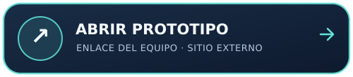</a>
<a href="https://openbridge.glossycow67.chatgpt.site/#asistente" title="Abrir directamente la sección Asistente de OpenBridge">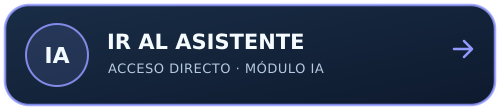</a>

</div>

<sub>**Evidencia:** el GIF y el MP4 proceden de una grabación auténtica enviada por el equipo y ya están alojados en este repositorio. En ella se observan la portada, navegación, catálogo, algunas fichas y filtros; **no demuestra una respuesta completa del asistente**, ni valida la exactitud de todos los datos. El funcionamiento puede cambiar durante el desarrollo.</sub>

### Recorrido de producto para quien evalúa

<table>
<tr>
<td width="33%" valign="top"><strong>01 · Explorá</strong><br />Abrí el prototipo y observá la navegación e identidad visual actuales.</td>
<td width="33%" valign="top"><strong>02 · Identificá</strong><br />Revisá las funciones disponibles y distinguí las ya integradas de las previstas en el desafío.</td>
<td width="33%" valign="top"><strong>03 · Probá el asistente</strong><br />Ingresá a la <a href="https://openbridge.glossycow67.chatgpt.site/#asistente">sección del asistente</a> para evaluar su comportamiento en esta versión.</td>
</tr>
</table>

**Demo real publicada:** [Ver el video completo (MP4, 57 s)](assets/showcase/OpenBridge_Recorrido_Real_57s.mp4) · [Vista previa animada (GIF)](assets/showcase/OpenBridge_Recorrido_Real.gif) · [Ver una captura estática real (PNG)](assets/showcase/OpenBridge_Portada_Real.png). Las versiones de GitHub fueron optimizadas para carga rápida; la edición original de mayor resolución se conserva en el paquete de entrega. [Evidencia y límites de la grabación](docs/09_RECORRIDO_REAL_Y_VIDEO.md) · [Protocolo de grabación](docs/08_DEMO_Y_RECORRIDO.md).

### Documentación vinculada al avance

<div align="center">

<a href="https://drive.google.com/file/d/1jl3HN2pWct3DZLqGiusHl49pQeCpu_EO/view" title="Abrir el documento oficial del desafío No Country">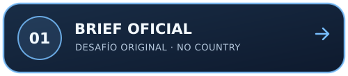</a>
<a href="https://app.notion.com/p/3ff997f897ee81d6bc48d1d36b2603fd?pvs=204" title="Abrir documentación y entregables del proyecto en Notion">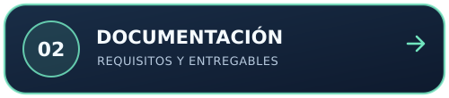</a>

<br />

<a href="https://app.notion.com/p/3ff997f897ee81f3a11cea1379ea28a6?pvs=204" title="Abrir la gestión general del proyecto OpenBridge en Notion"></a>
<a href="https://app.notion.com/p/9aa45edd39dd45ec96f91a1962b9b932?pvs=204" title="Abrir tablero de tareas y seguimiento de avances">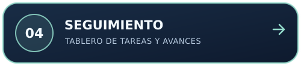</a>

</div>

**Lectura técnica complementaria:** [Arquitectura propuesta](#arquitectura-propuesta) · [Recorrido para la demo](docs/08_DEMO_Y_RECORRIDO.md) · [Centro de documentación](#centro-de-documentacion).

<sub>Los vínculos de Drive y Notion apuntan a documentos existentes, pero sus permisos de lectura para jueces externos todavía deben comprobarse.</sub>

---

## De una idea a una arquitectura

**Ejemplo ilustrativo, no una demostración del software:**

**Necesidad:** «Estoy creando un e-commerce B2B para operaciones logísticas».

```text
NECESIDAD DEL NEGOCIO
        │
        ▼
CONTEXTO + REQUISITOS
        │
        ▼
CATÁLOGO DE REPOSITORIOS
        │
        ▼
RELEVANCIA + MANTENIMIENTO + LICENCIA
        │
        ▼
STACK SUGERIDO + PATRONES DE INTEGRACIÓN
        │
        ▼
EXPLICACIÓN Y REVISIÓN HUMANA
```

El sistema debe apoyar decisiones técnicas, no reemplazar la evaluación de seguridad, licencias, costos, soporte o compatibilidad.

## Arquitectura propuesta

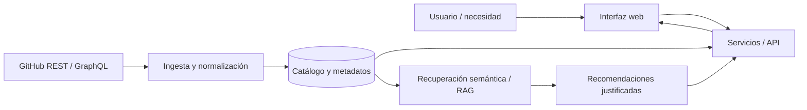

**Puntos de diseño pendientes de validar:**

- Estrategia de sincronización y límites de las API de GitHub.
- Modelo de indicadores de salud y actualización del repositorio.
- Recuperación semántica, calidad de las fuentes y trazabilidad de recomendaciones.
- Estructuración de integraciones, compatibilidad y ejemplos reproducibles.
- Contrato frontend/backend, pruebas, despliegue y seguridad.

**Tecnologías:** el desafío sugiere Next.js/React, FastAPI o Node.js, PostgreSQL/pgvector o Qdrant y herramientas para RAG. **Ninguna de estas alternativas se declara aquí como tecnología implementada sin validación del equipo.**

## Centro de documentacion

> **Evaluadores:** pueden comenzar por el documento de requisitos, continuar por el espacio de gestión y revisar las tareas y decisiones. Estos enlaces llevan a fuentes existentes, pero su **acceso público debe verificarse antes de la entrega final**.

| Fuente | Qué permite consultar |
|---|---|
| [**Acceso al prototipo**](https://openbridge.glossycow67.chatgpt.site/#asistente) | Vista compartida por el equipo; contenido sujeto a revisión. |\n| [**Guía de recorrido y evidencia**](docs/08_DEMO_Y_RECORRIDO.md) | Flujo recomendado, vídeo/GIF real y control de capturas. |\n| [**Brief oficial de No Country**](https://drive.google.com/file/d/1jl3HN2pWct3DZLqGiusHl49pQeCpu_EO/view) | Problema, alcance, entregables y tecnologías sugeridas. |
| [**Gestión del proyecto · Notion**](https://app.notion.com/p/3ff997f897ee81f3a11cea1379ea28a6?pvs=204) | Centro de coordinación y organización del equipo. |
| [**Documentación y entregables**](https://app.notion.com/p/3ff997f897ee81d6bc48d1d36b2603fd?pvs=204) | Requisitos, evidencias y control de entrega. |
| [**Tablero de tareas**](https://app.notion.com/p/9aa45edd39dd45ec96f91a1962b9b932?pvs=204) | Avances, responsables y criterios de aceptación. |
| [**Decisiones y riesgos**](https://app.notion.com/p/def7d0d2fd044dd0a5ec18cfcf964659?pvs=204) | Registro de acuerdos, incertidumbres y bloqueos. |
| [**Reuniones**](https://app.notion.com/p/d798a39cb79b4d5284d80650516b6123?pvs=204) | Registro del trabajo colaborativo. |
| [**Carpeta OpenBridge · Drive**](https://drive.google.com/drive/folders/1EQS0Utv815jEGypP3ApMJfVABJA02h7B) | Recursos y archivos compartidos del proyecto. |

**Pendientes para completar esta navegación:** repositorio de código del equipo, capturas reales verificadas, documentación técnica validada, video de presentación y resultados de pruebas. El prototipo ya tiene un enlace suministrado por el equipo, sin auditoría de su funcionamiento.

## Nuestro equipo

<div align="center">

### El talento detrás de OpenBridge

**Cuatro disciplinas. Un objetivo: transformar problemas reales en productos tecnológicos.**

Diseño, coordinación, inteligencia artificial y datos: conocé a las personas detrás de cada decisión.

</div>

<table>
<tr>
<td align="center" width="50%" valign="top">
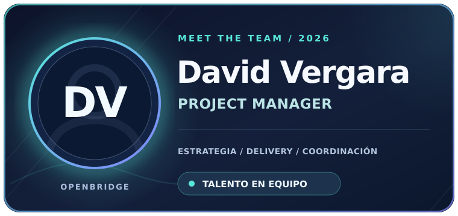
<br />
<strong>David Vergara</strong><br />
<sub>Project Manager</sub><br /><br />
<a href="https://github.com/marcketingdigital-cloud" title="Visitar GitHub de David Vergara"></a>
<a href="https://www.linkedin.com/in/jhonatanremon" title="Conectar con David Vergara en LinkedIn"></a>
</td>
<td align="center" width="50%" valign="top">
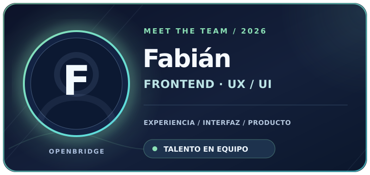
<br />
<strong>Fabián</strong><br />
<sub>Frontend · UX/UI</sub><br /><br />
<a href="https://github.com/fabianmartinezcaro" title="Visitar GitHub de Fabián"></a>
<a href="https://www.linkedin.com/in/fabianmartinezcaro/" title="Conectar con Fabián en LinkedIn"></a>
</td>
</tr>
<tr>
<td align="center" width="50%" valign="top">
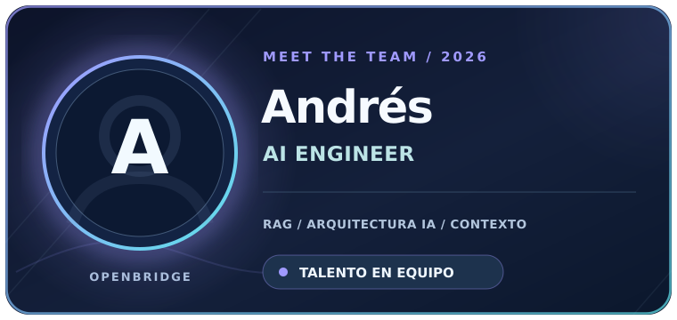
<br />
<strong>Andrés</strong><br />
<sub>Ingeniería de IA</sub><br /><br />
<a href="https://github.com/andigles" title="Visitar GitHub de Andrés"></a>
<a href="https://www.linkedin.com/in/andigles/es" title="Conectar con Andrés en LinkedIn"></a>
</td>
<td align="center" width="50%" valign="top">
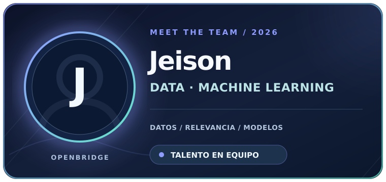
<br />
<strong>Jeison</strong><br />
<sub>Datos · Machine Learning</sub><br /><br />
<a href="https://github.com/Jeisz" title="Visitar GitHub de Jeison"></a>
<a href="https://www.linkedin.com/in/jeison-zapata-gpti" title="Conectar con Jeison en LinkedIn"></a>
</td>
</tr>
</table>

> **Perfiles profesionales:** los cuatro GitHub están enlazados. LinkedIn y GitHub están enlazados para los cuatro integrantes. Los avatares siguen siendo ilustraciones temporales hasta recibir fotografías autorizadas. Solo se presentan las dos redes acordadas.

La distribución técnica detallada se confirmará con el equipo. Backend, integración y pruebas siguen con responsables por acordar.

<a id="open-to-opportunities"></a>

<div align="center">

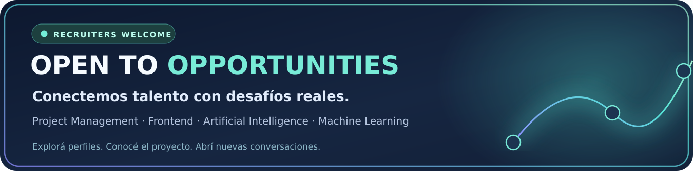

### ¿Reclutás talento para tu próximo proyecto?

**Conocé al equipo que está construyendo OpenBridge.** Explorá la propuesta, evaluá nuestras especialidades y conectá por GitHub o LinkedIn con perfiles identificados.

<a href="https://github.com/marcketingdigital-cloud/marcketingdigital-cloud/tree/main/proyectos/openbridge"></a>
<a href="https://github.com/marcketingdigital-cloud"></a>

<sub>La disponibilidad para oportunidades laborales debe ser confirmada por cada integrante. Los enlaces a GitHub y LinkedIn se vinculan a los perfiles compartidos por los integrantes.</sub>

</div>

## Estado y transparencia

| Dimensión | Estado en esta presentación |
|---|---|
| Problema de negocio y requisitos | **Documentados** en el brief. |
| Dirección del producto | **Propuesta definida**. |
| Coordinación y documentación | **Espacio real identificado** en Notion. |
| Arquitectura | **Conceptual**, pendiente de validación técnica. |
| Catálogo, asistente, ingesta y datos | **Entrega y evidencias pendientes de verificar**. |
| Prototipo del equipo | **Enlace incorporado y navegación documentada en video real**, sin verificación independiente de todas las funciones. |\n| Video de producto / GIF real | **Publicados en GitHub**; basados en navegación grabada por el equipo, sin demostración completa de respuesta del asistente. |
| README visual | **Versión de prueba publicada**, complementable por el equipo. |

## Camino hacia la demo

1. **Alinear alcance:** validar las funciones mínimas que se mostrarán.
2. **Construir un recorrido completo:** búsqueda → ficha → recomendación.
3. **Integrar y probar:** datos reales, contratos entre componentes y respuesta reproducible.
4. **Documentar con evidencia:** capturas, instrucciones de ejecución, resultados y limitaciones.
5. **Presentar al jurado:** demo, decisiones técnicas, aportes del equipo y próximos pasos.

---

<div align="center">

### Menos búsqueda. Mejores decisiones.

**OpenBridge** · Descubrir tecnologías es el comienzo; integrarlas con criterio es el objetivo.

[Inicio](#el-desafio) · [Producto](#producto) · [Documentación](#centro-de-documentacion) · [Equipo](#nuestro-equipo)

<sub>Simulación laboral No Country · Documento de presentación conceptual · Octubre de 2026</sub>

</div>